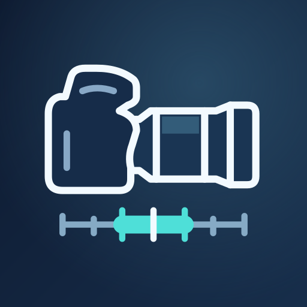
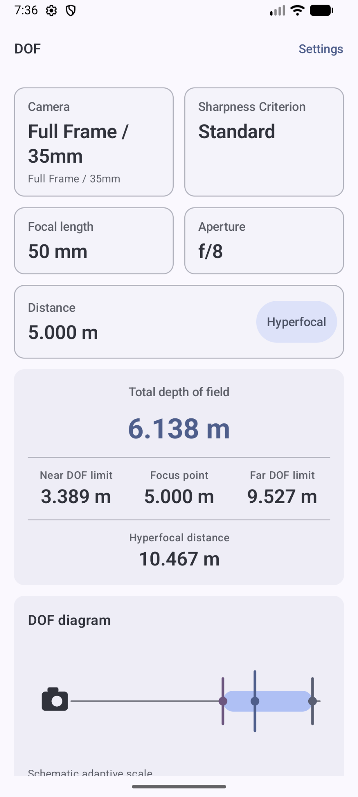
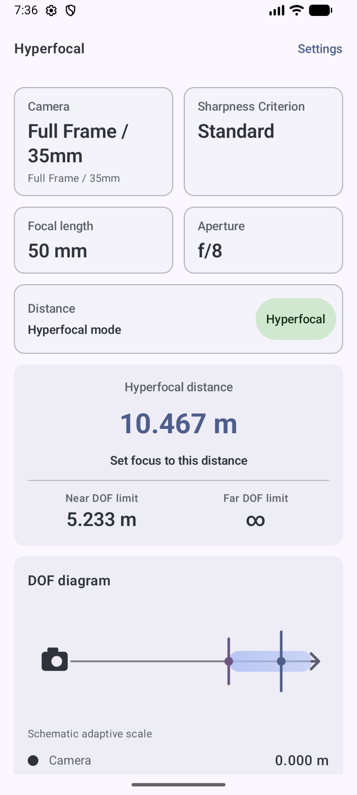
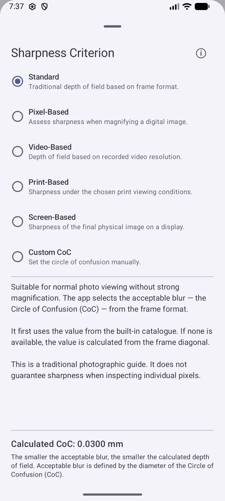

  

  <h1>DoF Master</h1>

  
<strong>Depth of field and hyperfocal distance, wherever you shoot.</strong>

  
For photography and video. No internet required.

  
<strong>Android 8.0+</strong> &nbsp;·&nbsp; <strong>Fully offline</strong> &nbsp;·&nbsp; <strong>English / Русский</strong>

  
English &nbsp;|&nbsp; <a href="README.ru.md">Русский</a>

  
<a href="https://github.com/karrrphoto-hub/DoF-Master/releases/download/v1.0.1/DoF-Master-1.0.1.apk"><strong>Download APK · DoF Master 1.0.1</strong></a>

  
Android 8.0+ &nbsp;·&nbsp; Signed Release APK &nbsp;·&nbsp; No sign-in required

  
<a href="https://github.com/karrrphoto-hub/DoF-Master/releases/tag/v1.0.1">Release notes and SHA-256 checksum</a>

---

DoF Master helps you estimate how much of a scene will appear sharp. Choose your camera, focal length, aperture and focus distance to see the near and far depth of field limits, total depth of field and a visual diagram.

For landscapes, switch to hyperfocal mode to find the focus distance that extends the far depth of field limit to infinity.

<table>
  <tr>
    <th>Depth of field</th>
    <th>Hyperfocal distance</th>
    <th>Sharpness criterion</th>
  </tr>
  <tr>
    <td></td>
    <td></td>
    <td></td>
  </tr>
</table>

*Actual app screenshots. Both English and Russian interfaces are available.*

## Features

- **Depth of field and hyperfocal distance.** Near and far limits, total depth of field and a diagram of the scene.
- **Flexible distance input.** An adaptive slider, manual entry and an explicit optical infinity setting.
- **Your cameras and lenses.** Custom camera profiles with physical frame dimensions and kits of prime and zoom lenses.
- **Quick values from your kit.** All lenses attached to a custom camera contribute focal length and aperture presets. Unusual values are preserved, and manual input is always available.
- **Information without restrictions.** Independent diffraction and close focus messages explain calculation limits without changing your shooting parameters.
- **Make it yours.** English and Russian, light, dark and system themes, measurement units and number formatting options.

## Sharpness for your output

Visible blur depends on how an image is viewed. DoF Master offers six criteria:

| Criterion | Purpose |
| --- | --- |
| **Standard** | Normal photo viewing. Uses the format's catalogue value, or a calculation based on the physical frame diagonal when no value is defined. |
| **Pixel-Based** | Assessing an enlarged digital image using sensor resolution. |
| **Video-Based** | Depth of field based on recorded video resolution. |
| **Print-Based** | A chosen print size and viewing conditions. |
| **Screen-Based** | Viewing an image on a chosen display. |
| **Custom** | Setting the Circle of Confusion (CoC) manually. |

When Standard has no catalogue value, it uses the traditional photographic reference of a 36×24 mm frame with a 0.030 mm Circle of Confusion, scaled by the frame diagonal. Explicit built-in catalogue values take priority.

Calculations help plan a shot; they do not guarantee identical detail from every real lens. At close distances, simplified optical assumptions can differ more noticeably from a lens's actual behaviour. Informational messages explain these limits while keeping all results available.

## Cameras and quick values

Create a custom camera profile and add your lenses. A kit such as **24–120 mm f/4 + 50 mm f/1.4 + 200 mm f/4** produces useful presets across the whole set. There is no active lens to select.

Zooms contribute standard focal lengths within each individual range and their exact endpoints. A 58 mm prime or a 48–217 mm zoom keeps its own values. Aperture presets account for the maximum apertures and specified minimum apertures across the kit.

**Show All Focal Lengths** and **Show All Apertures** work independently. A filtered preset list never prevents you from entering another valid value manually.

## Offline by design

The app runs locally, with no advertising, analytics, accounts or telemetry. It does not request internet permission. Profiles and preferences are stored on the device.

## Installation

1. [Download the signed Release APK](https://github.com/karrrphoto-hub/DoF-Master/releases/download/v1.0.1/DoF-Master-1.0.1.apk) on your Android device.
2. Open the downloaded file and, if prompted, allow your browser or file manager to install this app.
3. Complete installation. Android 8.0 or newer is required.

The [release page](https://github.com/karrrphoto-hub/DoF-Master/releases/tag/v1.0.1) includes a SHA-256 checksum for verifying the download.

If you previously installed a private Debug build, this Release uses a different signing certificate and cannot update it in place. Keep the old installation if you need its saved profiles; uninstalling it can erase app data.

## About this repository

This repository contains the app description, icon, screenshots and downloadable installation files under Releases. The app's source code is not included here.

---

  <strong>DoF Master</strong> 
  Plan your depth of field. Keep your creative choices.

