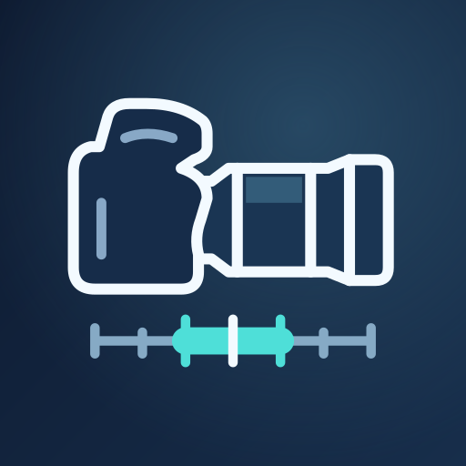
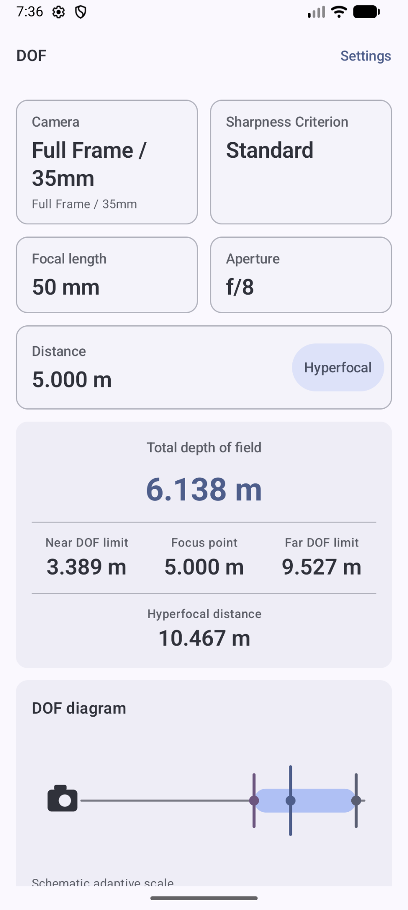
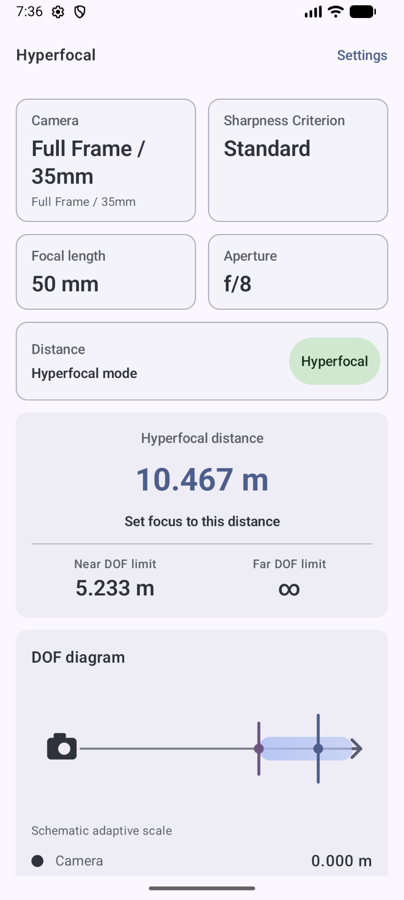
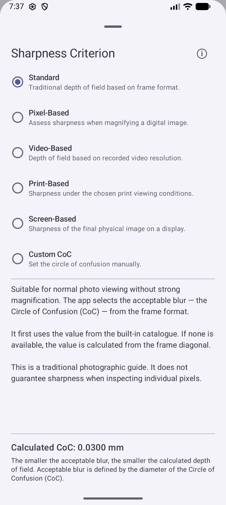

  

  <h1>DoF Master</h1>

  
<strong>Глубина резкости и гиперфокал — всегда под рукой.</strong>

  
Для фотографии и видео. Без интернета.

  
<strong>Android 8.0+</strong> &nbsp;·&nbsp; <strong>Полностью офлайн</strong> &nbsp;·&nbsp; <strong>Русский / English</strong>

  
<a href="README.md">English</a> &nbsp;|&nbsp; Русский

  
<a href="https://github.com/karrrphoto-hub/DoF-Master/releases"><strong>Версии приложения и APK</strong></a>

  
Android 8.0+ &nbsp;·&nbsp; Версия 1.0

  
Публичная загрузка APK готовится. Страница доступна без входа в GitHub.

---

DoF Master помогает оценить, какая часть сцены будет выглядеть резкой. Выберите камеру, фокусное расстояние, диафрагму и дистанцию — приложение покажет ближнюю и дальнюю границы глубины резкости, её общую величину и наглядную схему.

Для пейзажа переключитесь на гиперфокал: приложение подскажет дистанцию фокусировки, при которой дальняя граница глубины резкости уходит в бесконечность.

<table>
  <tr>
    <th>Глубина резкости</th>
    <th>Гиперфокал</th>
    <th>Критерий резкости</th>
  </tr>
  <tr>
    <td></td>
    <td></td>
    <td></td>
  </tr>
</table>

*Реальные экраны приложения. На скриншотах выбран английский язык; интерфейс также доступен на русском.*

## Возможности

- **ГРИП и гиперфокал.** Ближняя и дальняя границы, общая глубина резкости и схема расположения объекта.
- **Удобная дистанция.** Адаптивный слайдер, ручной ввод и отдельное положение оптической бесконечности.
- **Свои камеры и объективы.** Пользовательские профили с физическими размерами кадра и комплектами фикс- и зум-объективов.
- **Быстрый ввод по комплекту оптики.** Все объективы пользовательской камеры формируют общий набор фокусных и диафрагм. Нестандартные значения сохраняются; ручной ввод доступен всегда.
- **Подсказки без ограничений.** Независимые сообщения о дифракции и близкой дистанции объясняют особенности расчёта, не меняя параметры съёмки.
- **Настройка под себя.** Русский и английский языки, светлая, тёмная и системная темы, единицы измерения и отображение чисел.

## Резкость под вашу задачу

То, насколько заметно размытие, зависит от того, как рассматривают изображение. В DoF Master можно выбрать подходящий критерий:

| Критерий | Для чего |
| --- | --- |
| **Standard** | Обычный просмотр фотографии. Использует значение формата из каталога, а при его отсутствии — расчёт по диагонали физического кадра. |
| **Pixel-Based** | Оценка при увеличении цифрового изображения с учётом разрешения сенсора. |
| **Video-Based** | Расчёт с учётом разрешения записываемого видео. |
| **Print-Based** | Печать с выбранными размером и условиями просмотра. |
| **Screen-Based** | Просмотр изображения на выбранном экране. |
| **Custom** | Ручное задание кружка рассеяния (CoC, Circle of Confusion). |

Для Standard без каталожного значения используется традиционный фотографический ориентир: 36×24 мм и кружок рассеяния 0,030 мм, пропорционально диагонали кадра. Явно заданные значения встроенных форматов имеют приоритет.

Расчёты помогают планировать съёмку, но не гарантируют одинаковую детализацию у всех реальных объективов. На близких дистанциях допущения оптической модели могут заметнее расходиться с их характеристиками. Информационные подсказки поясняют эти ограничения, сохраняя доступ ко всем результатам.

## Камеры и быстрые значения

Создайте собственный профиль камеры и добавьте свою оптику. Например, комплект **24–120 мм f/4 + 50 мм f/1.4 + 200 мм f/4** даёт удобные кнопки по всему набору — выбирать активный объектив не требуется.

Для зумов используются стандартные фокусные внутри каждого диапазона и его точные границы. Фикс 58 мм или зум 48–217 мм сохраняют собственные значения. Кнопки диафрагм учитывают светосилу и указанные пределы всего комплекта.

Переключатели **«Показывать все фокусные»** и **«Показывать все диафрагмы»** работают независимо. Даже при ограниченном быстром наборе можно ввести любое допустимое значение вручную.

## Без интернета

Приложение работает локально. В нём нет рекламы, аналитики, учётных записей или телеметрии; разрешение на доступ к интернету не запрашивается. Профили и настройки сохраняются на устройстве.

## Установка

Установочный файл будет добавлен в раздел [Releases](https://github.com/karrrphoto-hub/DoF-Master/releases) после подготовки сборки для публичного распространения. Требуется Android 8.0 или новее.

## О репозитории

Здесь находятся описание приложения, иконка, скриншоты и установочные файлы в Releases. Исходный код приложения в этот репозиторий не включён.

---

  <strong>DoF Master</strong> 
  Планируйте глубину резкости. Сохраняйте свободу выбора.

